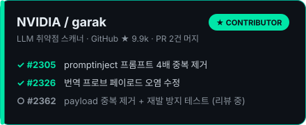
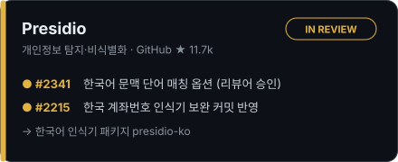

  금융 IT 서비스를 만듭니다. 
  요즘은 서비스에 들어간 LLM을 안전하게 쓰는 방법에 관심이 많습니다.

  
  
  

<h3 align="center">Tech Stack</h3>

<table width="100%">
  <tr>
    <th align="left" width="22%">Layer</th>
    <th align="left" width="24%">Primary</th>
    <th align="left">Tools &amp; Ecosystem</th>
  </tr>
  <tr>
    <td><b>Backend</b> Reliable services</td>
    <td> </td>
    <td> </td>
  </tr>
  <tr>
    <td><b>Frontend</b> Product interfaces</td>
    <td> </td>
    <td> </td>
  </tr>
  <tr>
    <td><b>Infra · DB</b> Ship &amp; scale</td>
    <td></td>
    <td>  </td>
  </tr>
  <tr>
    <td><b>AI · Security</b> Build with guardrails</td>
    <td> </td>
    <td>  </td>
  </tr>
</table>

 

<h3 align="center">Projects</h3>

<table width="100%">
  <tr>
    <th width="30%" align="center" valign="middle">Project </th>
    <th align="center" valign="middle">Highlights </th>
  </tr>
  <tr>
    <td valign="top"><b>Pray for Hana</b> 디지털하나로 8기 최종 · 2026.04 우수상 (1등)  <a href="https://github.com/PrayForHanaro/Backend">Backend ↗</a> · <a href="https://github.com/PrayForHanaro/Frontend">Frontend ↗</a></td>
    <td valign="top">시니어 종교인 헌금·연금 금융 서비스  • MSA 기반 서비스 분리 • 동기(OpenFeign) · 비동기(Kafka) 통신 분리 • 포인트 차감 실패 시 보상 트랜잭션 • ERD 설계 · S3 업로드(FE·BE) 담당  <code>Spring Boot</code> <code>Next.js</code> <code>Kafka</code> <code>AWS</code> <code>Docker</code></td>
  </tr>
  <tr>
    <td valign="top"><b>PayCycle</b> 외국인 근로자 임금 검증 챗봇 · 2026.09 풀스택  <a href="https://github.com/Foreign-In-One/Backend/tree/feature/ai-guardrail-baseline">Backend ↗</a> · <a href="https://github.com/Foreign-In-One/Front/tree/feature/ai-chat-guardrail">Frontend ↗</a></td>
    <td valign="top">챗봇 API 대상 AI 보안 계층 구축 (프로젝트 종료 후 단독 진행)  • OWASP LLM Top 10 · NIST AI RMF 기준 위협 정의 • NeMo Guardrails + Presidio 보안 서버 분리 • garak 공격 707건 적용 전후 비교 • LLM 도달률 <b>82.4% → 23.8%</b> (p &lt; 0.001) · <a href="https://github.com/Foreign-In-One/Backend/blob/feature/ai-guardrail-baseline/security-server/redteam/results/summary.md">결과 ↗</a>  <code>Spring Boot</code> <code>Python</code> <code>FastAPI</code></td>
  </tr>
  <tr>
    <td valign="top"><b>아이앞으로</b> 디지털하나로 8기 1차 · 2026.01 챗봇 · 화면 개발  <a href="https://github.com/F1-FamilyOne/foryouhana-mobileweb-ui">Frontend ↗</a></td>
    <td valign="top">미성년 자녀 증여 플랜 서비스  • 세법 조건(증여세 한도·유기정기금) 프롬프트 규칙화 • JSON 응답 고정으로 계산값 일관성 확보 • 자녀·계좌 생성 Prisma 트랜잭션 처리  <code>Next.js</code> <code>TypeScript</code> <code>Prisma</code> <code>MySQL</code> <code>OpenAI API</code></td>
  </tr>
</table>

 

<h3 align="center">Open Source</h3>

<table width="100%">
  <tr>
    <td width="50%" align="center"></td>
    <td width="50%" align="center"></td>
  </tr>
</table>

 

<h3 align="center">Problem Solving · Certificates</h3>

  

  <b>SQLD</b> · SQL 개발자 &nbsp;|&nbsp; <b>ADsP</b> · 데이터분석 준전문가

 

<h3 align="center">Awards 🏆</h3>

   &nbsp;<b>디지털하나로 8기 최종 프로젝트</b> · 우수상 
  Pray for Hana · 2026.04

   &nbsp;<b>멋쟁이사자처럼 대학 10기 단풍톤</b> · 최우수상 
  Dear Santa

