
<picture><source media="(prefers-color-scheme: dark)" srcset="assets/hero-dark.svg">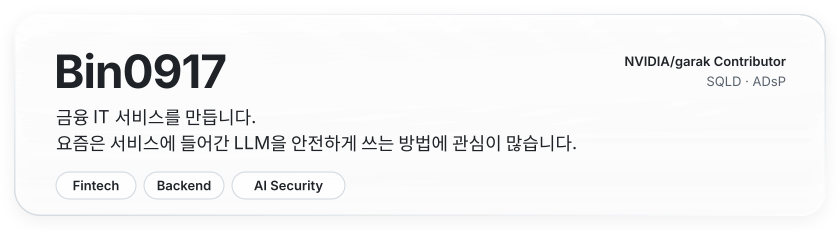</picture>

  
  
  

## Projects

<a href="https://github.com/PrayForHanaro/Backend"><picture><source media="(prefers-color-scheme: dark)" srcset="assets/project-prayforhana-dark.svg">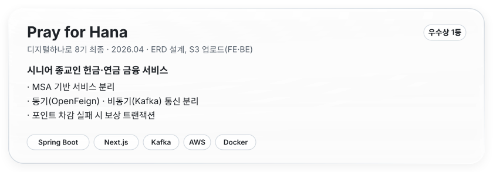</picture></a>

<a href="https://github.com/PrayForHanaro/Backend">Backend ↗</a> · <a href="https://github.com/PrayForHanaro/Frontend">Frontend ↗</a>

<a href="https://github.com/Foreign-In-One/Backend/tree/feature/ai-guardrail-baseline"><picture><source media="(prefers-color-scheme: dark)" srcset="assets/project-paycycle-dark.svg">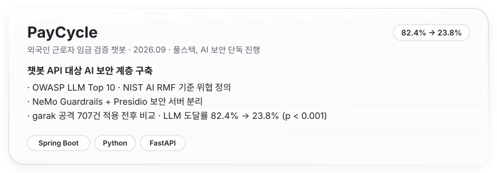</picture></a>

<a href="https://github.com/Foreign-In-One/Backend/tree/feature/ai-guardrail-baseline">Backend ↗</a> · <a href="https://github.com/Foreign-In-One/Front/tree/feature/ai-chat-guardrail">Frontend ↗</a> · <a href="https://github.com/Foreign-In-One/Backend/blob/feature/ai-guardrail-baseline/security-server/redteam/results/summary.md">레드티밍 결과 ↗</a>

<a href="https://github.com/F1-FamilyOne/foryouhana-mobileweb-ui"><picture><source media="(prefers-color-scheme: dark)" srcset="assets/project-aiapeuro-dark.svg">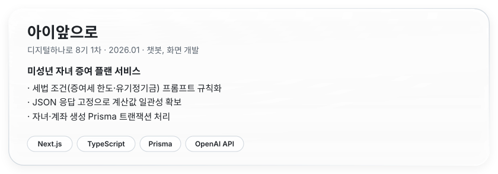</picture></a>

<a href="https://github.com/F1-FamilyOne/foryouhana-mobileweb-ui">Frontend ↗</a>

## Open Source

  <a href="https://github.com/NVIDIA/garak/pulls?q=is%3Apr+author%3ABin0917"><picture><source media="(prefers-color-scheme: dark)" srcset="assets/oss-garak-dark.svg">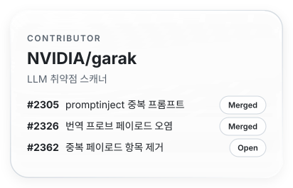</picture></a>
  <a href="https://github.com/data-privacy-stack/presidio/pull/2341"><picture><source media="(prefers-color-scheme: dark)" srcset="assets/oss-presidio-dark.svg">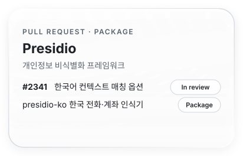</picture></a>

  <a href="https://github.com/NVIDIA-NeMo/Guardrails/issues?q=is%3Aissue+author%3ABin0917"><picture><source media="(prefers-color-scheme: dark)" srcset="assets/oss-nemo-dark.svg">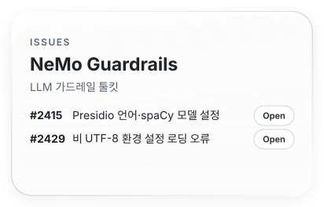</picture></a>
  <a href="https://github.com/openai/openai-guardrails-python/issues/151"><picture><source media="(prefers-color-scheme: dark)" srcset="assets/oss-openai-dark.svg">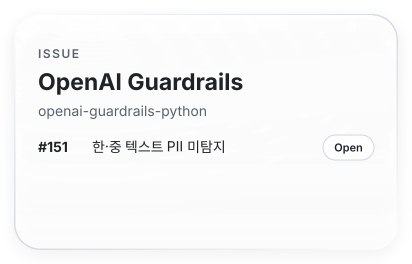</picture></a>

<a href="https://github.com/Bin0917/presidio-ko">presidio-ko ↗</a> · <a href="https://github.com/NVIDIA/garak/pull/2362">garak #2362 ↗</a>

## Skills

<picture><source media="(prefers-color-scheme: dark)" srcset="assets/skills-dark.svg">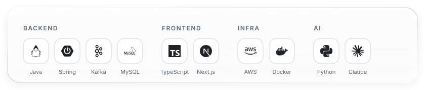</picture>

## Awards

  <picture><source media="(prefers-color-scheme: dark)" srcset="assets/award-hana-dark.svg">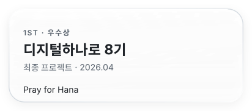</picture>
  <picture><source media="(prefers-color-scheme: dark)" srcset="assets/award-santa-dark.svg">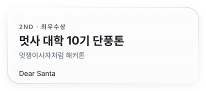</picture>

