<a href="mailto:leesd132@naver.com">leesd132@naver.com</a> · <a href="mailto:leesd365@gmail.com">leesd365@gmail.com</a> · <a href="https://solved.ac/profile/shfur132">solved.ac</a>

Pray for Hana <a href="https://github.com/PrayForHanaro/Backend">BE</a> · <a href="https://github.com/PrayForHanaro/Frontend">FE</a> &nbsp;|&nbsp; PayCycle <a href="https://github.com/Foreign-In-One/Backend/tree/feature/ai-guardrail-baseline">BE</a> · <a href="https://github.com/Foreign-In-One/Front/tree/feature/ai-chat-guardrail">FE</a> · <a href="https://github.com/Foreign-In-One/Backend/blob/feature/ai-guardrail-baseline/security-server/redteam/results/summary.md">레드티밍 결과</a> &nbsp;|&nbsp; 아이앞으로 <a href="https://github.com/F1-FamilyOne/foryouhana-mobileweb-ui">FE</a>

<a href="https://github.com/NVIDIA/garak/pulls?q=is%3Apr+author%3ABin0917">garak PRs</a> · <a href="https://github.com/data-privacy-stack/presidio/pull/2341">presidio #2341</a> · <a href="https://github.com/Bin0917/presidio-ko">presidio-ko</a> · <a href="https://github.com/NVIDIA-NeMo/Guardrails/issues?q=is%3Aissue+author%3ABin0917">NeMo issues</a> · <a href="https://github.com/openai/openai-guardrails-python/issues/151">OpenAI #151</a>

